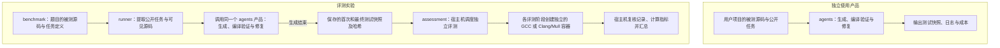
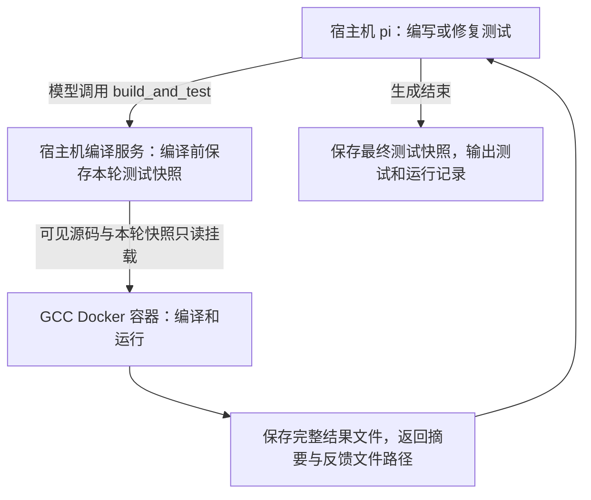

# Qualtor

Qualtor 为已有 **C++11 代码生成 GoogleTest 单元测试**，并独立评价生成测试的质量和成本，用于比较、改进模型、Agent、提示词与 skill 的组合。测试断言以被测代码的实际行为为准。

项目分为生成产品和评测系统。**交付给用户的是完整的 `agents/` 目录**，其中包含 pi、生成与修复流程、工具限制、编译服务、日志、成本和所需的 GCC 工具链。`evaluator/` 使用这个产品组织实验，并在生成结束后独立评测测试。

## 系统怎样运行

**独立使用产品**时，用户提供自己的被测源码和公开任务，由 `agents/` 生成、编译验证和修复测试，最后输出测试及运行记录。

**运行评测实验**时，被测源码来自 `benchmark/<题目>/source/`。`evaluator/runner/` 根据题目定义提取公开任务和允许可见的源码，调用同一个生成产品。每个 trial 生成结束后，才交给 `assessment` 分别评测首次和最终测试。



两条路径使用相同的**生成与修复流程**：pi 在宿主机编写测试，模型主动调用 pi 扩展注册的 `build_and_test` 工具。宿主机编译服务在**编译前保存本轮测试快照**：复制当前测试、记录文件哈希，再将可见源码和本轮快照只读挂入 GCC Docker 容器。编译结果对应这份快照，Agent 可以根据反馈继续修改工作区中的测试。



独立评测沿用该题的被测源码，并按需读取题目参数和隐藏评测材料；隐藏材料不提供给生成 Agent。宿主机 Python 调度容器：GCC 负责有效性、稳定性、覆盖率和替换版本执行，Clang/Mull 负责变异测试。执行完成后，宿主机复核记录、计算指标，并按 trial、题目和 Agent 配置汇总结果。哈希用于核对测试内容，随快照保存。

`agents/generator/` 管理单次生成的工作区、工具权限、修复预算、错误重试和日志；`evaluator/runner/` 管理选题、多次 trial、并发以及生成与评测的衔接。runner 通过 `agents/run.py` 的公开 CLI 调用产品。

两套工具链是**两类镜像**，执行时按阶段创建容器。生成与评测可以复用 GCC 镜像，但容器、构建目录和构建模板分开。pi 在宿主机运行，没有 pi 生成容器。生成阶段只接收普通编译和测试反馈，隐藏评测结果不会送回正在生成的 Agent。

## 项目目录

下面只列主要模块和关键入口，具体用法见后面的文档导航。

```text
Qualtor/
├── agents/                  # 可独立交付的测试生成产品
│   ├── run.py               # 单次生成入口
│   ├── setup.py             # 安装宿主机 pi 和 GCC 工具链
│   ├── pi/                  # pi Agent 框架源码
│   ├── generator/           # 生成与修复、工具限制、编译服务和运行记录
│   └── toolchains/          # 产品使用的 GCC / GoogleTest Docker 工具链
├── evaluator/               # 批量实验与独立评测
│   ├── run.py               # 批量实验入口
│   ├── runner/              # 选题、多次 trial，以及生成与评测的衔接
│   ├── assessment/          # 编译、稳定性、覆盖率、变异评测与指标计算
│   └── toolchains/          # Clang/Mull 镜像及两套 C++ 工具链的验收
├── benchmark/               # 评测题目，每道题一个目录
│   └── <task-id>/
│       ├── source/          # 被测项目源码
│       ├── task.json        # 任务定义、可见文件、预算和评测参数
│       └── hidden/          # 参考测试、变异基线及替换版本等评测材料
├── runs/                    # 每轮的测试快照、编译反馈、日志、成本与评测结果
└── docs/                    # 设计、运行说明、决策和研发记录
```

连接配置在 `agents/.env`，模型配置在 `agents/configs/`。产品可单独交付；评测系统通过产品 CLI 调用生成。详细说明见 [产品 README](agents/README.md)和 [文档索引](docs/README.md)。

## 评测哪些方面

当前**没有百分比权重，也不把各项指标加权合成总分**。评测输出各项结果，按主指标、门槛、守护指标和辅助诊断来判断质量。

| 评测方面 | 主要看什么 | 重要程度与用途 |
|---|---|---|
| 变异检出（M1） | Mull 自动修改业务代码后，测试能发现多少有效变异 | **主指标**：比较预算内修复后的端到端检出率，越高越好 |
| 有效性（V1–V3） | 能否编译、实际执行，并在原始被测代码上通过 | 基础门槛与守护指标：检查生成测试的可用性 |
| 稳定性（S1、S2） | 重复、乱序、单独运行时，结果是否一致 | 门槛与守护指标；不稳定测试占比越低越好，失败复现率辅助诊断 |
| 手写缺陷检出（M2） | 能否发现人为注入的业务缺陷 | 辅助验证与守护指标，单独报告，不并入 M1 |
| 抗误报（F1） | 业务行为等价的代码改写，是否导致测试失败或超时 | 守护指标：误报率越低越好 |
| 覆盖率（C1–C3） | 指定业务源码的行、分支和函数被执行了多少 | 辅助诊断：定位覆盖缺口，不能单独证明测试质量 |
| 生成成本（K1） | token、耗时、模型调用次数、修复轮次和费用 | 守护指标：检查质量提升付出的成本；未配置单价时不计算金额 |

首次与最终测试分别评测。主指标的“端到端”口径会将无效产物记为 0，使生成了但不可用的测试也反映在主指标中；跨题汇总时每道题权重相同。正式比较前需明确最小提升幅度及守护指标的容忍范围，用于判断检出能力提升是否伴随可靠性下降或成本增加。

真实缺陷检出（M4）已有执行接口，尚无真实缺陷题验证；增量覆盖（C4）和人类基线（H1）尚未接入。具体计算与比较规则见 [评分算法](docs/评分算法.md)。

## 从哪里开始

- **使用生成产品**：阅读 [产品 README](agents/README.md)，用 `agents/setup.py` 安装，在 `agents/.env` 配置连接，再通过 `agents/run.py` 提交公开任务。
- **运行批量实验**：阅读 [生成入口运行说明](docs/生成入口运行说明.md)，使用 `evaluator/run.py`。评测还需要 Clang/Mull 镜像及通过校准的 assessment。
- **评测已有测试或补评旧实验**：阅读 [评测运行说明](docs/评分器运行说明.md)，使用 `evaluator/assessment/evaluate.py`；汇总与比较使用同目录的 `aggregate.py`。
- **了解生成工具**：阅读 [产品接口与运行边界](agents/docs/接口与运行边界.md)，核对工具限制、编译反馈和生成状态；工具注册位于 `agents/generator/runtime/extension.ts`。
- **了解评测原理**：阅读 [评测模块与校准样本设计](docs/评测模块与校准样本设计.md)和 [评分算法](docs/评分算法.md)。

## 当前实现与验证范围

当前已接入 C++11 + GoogleTest，支持自动生成、预算内修复、保存首次/最终测试快照、独立评测和按版本补评。评测模块 **0.1.5** 已完成 GildedRose 的 **16 个样本各两次校准**，沿用 47 个冻结变异，判定与指标同 0.1.4 一致，见 [校准报告](evaluator/assessment/calibration_report.md)。

宿主机 pi 的真实 DeepSeek Flash / max 五次 trial 已完成，10 份首次/最终产物均完成评测；独立交付、自动修复、失败处理和改名后的闭环验证也已完成。各次验收的范围和原始证据见 [生成运行说明](docs/生成入口运行说明.md)与 [评测运行说明](docs/评分器运行说明.md)。

实际验证环境为 macOS ARM64 宿主机与 Linux ARM64 Docker；AMD64 已配置，尚未实测。当前只有一道公开开发题，尚无验收题和真实缺陷题，增量覆盖与人类基线也未接入。后续工作以 [项目推进流程](docs/项目推进流程.md)为准。

生成 Agent 的读写限制由工具白名单和路径检查实现，C++ 编译执行使用禁网、资源受限的 Docker；宿主机 pi 的限制不构成操作系统沙箱。产品与评测各自的具体保证和限制，见 [产品接口与边界](agents/docs/接口与运行边界.md)和 [评测设计](docs/评测模块与校准样本设计.md)。
