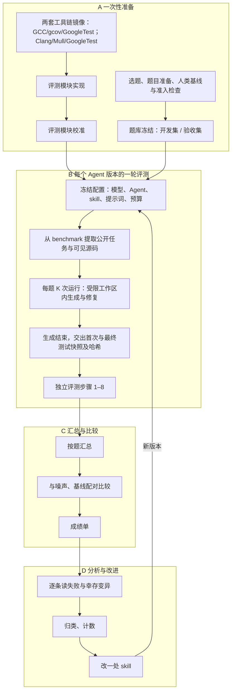

# 单元测试生成评测规格

> **v0.4 草案，2026-10-27 对齐当前实现。** 本文集中维护评测范围、术语、指标及后续工作。生成与评测链路已接通，但跨项目题集准入、噪声估计和正式比较阈值尚未确定，暂不冻结为 v1。已实现和已验证范围见第 6 节，后续工作见第 7 节。
>
> 执行结构见[评测实现与校准样本](评测模块与校准样本设计.md)，计算口径见[评分算法](评分算法.md)，已定决定及其理由见[决策记录](决策记录.md)。v0.3 按 D002 收窄评分范围；v0.4 确定生成、修复、日志、补评及等价版本口径，并按 D013/D014 对齐宿主机 pi、独立产品交付与 assessment 命名。

## 1. 评测对象与范围

- **评测对象**：一个“Agent 版本”，即模型、Agent 框架、skill、提示词的组合。给它一份已有的 C++ 代码，它全自动生成 GoogleTest 单元测试。
- **评的是什么**：Agent 生成的测试文件，以及生成过程的成本。
- **断言依据**：以被测代码的实际运行结果为准（D001）。产品通过禁网 Docker 为 Agent 提供编译、运行反馈。
- **不评什么**：
  - 代码是否符合需求，由后续功能测试负责；
  - 代码风格这类主观项，只做人工抽查，不计分；
  - 被测代码本身是否正确，因此题库不需要“确定正确的代码”。
- **基本单位**：一道题目是一段被测代码及其配套材料；每题执行 K 次 trial，成绩先按题汇总。一次批量 run 包含所选题目的全部 trial；同一配置重复执行使用新的 run（D006）。下文“每题 K 次运行”均指 K 个 trial。
- **被评测的 Agent 框架**：当前只接 pi，源码入库（D003）。

### 项目术语

| 术语 | 含义 |
|---|---|
| 生成产品（agents） | 根据已有代码自动生成、验证、修复测试，并保存测试快照的完整交付物 |
| 实验编排（runner） | 组织题目、配置与多次试验，连接生成产品与独立评测 |
| 测试评测（assessment） | 对测试快照的有效性、稳定性、缺陷检出、抗误报、覆盖范围及生成成本进行独立评价的完整过程 |
| 判定与指标计算（judge） | 把编译、运行和分析记录转为状态、计数与指标的确定性规则 |
| 试验（trial） | 同一道题的一次完整生成过程，包含预算内修复、必要的错误重试和首次、最终产物；每次完整生成尝试从空工作区开始 |
| 运行（run） | 一次实际执行及其记录；批量评测 run 可包含多道题、每题多个 trial |
| 测试快照 | 测试文件在某个时刻的固定副本，附带文件清单和内容哈希，用来对应编译或评测结果 |
| 本轮测试快照 | 一次编译验证开始前保存的测试快照；后续工作区修改不改变这份副本 |
| 首次／最终测试快照 | 首次编译前、生成结束时分别保存的快照；从未编译时，两份均取结束时内容 |
| 冻结产物 | 历史文档和接口对固定测试文件及哈希清单的称呼；生成流程说明统一使用“测试快照” |
| 稳定有效测试 | 在原始被测代码上通过，并通过重复、乱序及单独运行检查的测试 |

完整评测模块统一称 assessment；`scorer`、`score` 只在历史名称、兼容字段和结果路径中保留。编译前的保存动作统一表述为“编译前保存本轮测试快照”。

## 2. 测评内容

| 编号 | 内容 | 回答的问题 | 地位 |
|---|---|---|---|
| 一 | 有效性 | 生成的测试能不能用：编译得过、真的执行、在被测代码上通过 | 门槛：不过关的测试不参与后面的评分 |
| 二 | 稳定性 | 同一份测试反复跑、换顺序跑、单独跑，结果是否一致 | 门槛 + 守护指标 |
| 三 | 缺陷检出能力 | 代码被改坏时，测试能不能发现 | **主指标** |
| 四 | 抗误报能力 | 代码没被改坏（行为等价的改写）时，测试会不会失败 | 守护指标 |
| 五 | 覆盖率 | 测试执行到了哪些代码 | 诊断指标 |
| 六 | 成本与效率 | 花了多少 token、时间、修复轮次 | 守护指标 |

各层的用法：

- **门槛**决定一个测试或一次运行有没有资格参评。
- **主指标**用于比较 Agent 版本的好坏。
- **守护指标**要求在主指标提高的同时不能变差。
- **诊断指标**只用来解释原因，不单独下结论。

## 3. 测评方法

### 3.1 评测环境

- 宿主机 Python 调度测试评测、复核结果并计算指标；编译、测试和分析在 Docker 内完成：禁网，源码只读挂载，资源受限，命令和输出全程审计。当前分工见[评测模块与校准样本设计](评测模块与校准样本设计.md)。
- 生成按 D013 在宿主机 pi 中完成：产品提供公开任务、可见源码投影和工具级限制。每轮生成测试只读挂入禁网 GCC 容器编译，输出文件反馈给 pi；模型凭证只留在宿主机。隐藏评分材料不进入工作区或编译容器。宿主机 pi 不具备旧 D004 的 Docker OS 隔离保证。
- 镜像在构建阶段装好固定版本的工具链，评测容器内不联网下载。需要的工具：GCC、gcov、GoogleTest、Clang、Mull。
- C++ 业务代码和测试固定为 **C++11**；业务代码可含 C 源文件，按 `build.c_standard` 使用 ISO C99 或 C11（D017）。已落地版本为 GCC/gcov **14.2.0**、GoogleTest **1.12.1**、Clang/LLVM **19.1.7**、Mull **0.34.2**；镜像定义、使用方法与容器验收证据见 [C++11 固定工具链](C++11固定工具链.md)。
- **同一份源码分两套构建：**
  - **GCC 构建**：运行测试、统计 gcov 覆盖率、检查稳定性、执行替换版本。
  - **Clang 构建**：只用来跑 Mull 变异测试。

  两套构建使用同一份源码和测试，但 Mull 结论来自固定的 Clang 构建；比较时固定工具链、架构和编译选项。GCC 下通过而 Clang 编译错误全部明确定位到冻结测试文件时，按 D019 只令 M1_valid 为 null、M1_e2e 为 0；有效性和覆盖率仍由 GCC 判定。其他 Clang 失败记为基础设施错误。
- 生成的测试**单独**构建、单独运行，不和目标仓库已有的测试混在一起。每次运行前清空覆盖率数据。增量覆盖 C4 尚未接入；实现时需分别运行已有测试、生成测试、两者合并，三组分开统计。

### 3.2 题目来源与准备（每道题一次性完成，随题目冻结）

**选题标准**：优先选同时满足以下条件的 C++ 仓库或模块：

- 有现成的单元测试，可作为参考强测试集和人类基线的来源；
- 能用 GCC 和 Clang 两套构建编译，已有测试能跑通；
- 有缺陷修复历史，可从中构造真实缺陷题。

模型是否见过代码不作为准入条件（D017）。开发集采用公开代码与数据集；验收集采用内部生产代码并与开发调试隔离。公开测试可以作为参考和基线的来源，仍须通过质量验证。

每道题要准备的材料：

| 材料 | 说明 | 对被测 Agent |
|---|---|---|
| 被测代码与可见上下文 | 源码、头文件、构建方式；用 target_sources 或 target_headers 指定被测范围 | 可见 |
| 评分输入域 | 参考强测试集和有界穷举探针保证与被测代码一致的输入范围；不约束等价版本（D011） | 不可见 |
| 预算 | 修复轮次上限 R（`task.json` 的 `budget.repair_rounds`，初始值 3）；token 和时间只记录、不设上限（D005） | 可见 |
| 已有测试 | 目标仓库自带的单元测试 | 默认不可见。若生产场景是“在已有测试上补充”，设为可见并写进题目卡；可见与不可见两种设置的成绩分开比较 |
| 参考强测试集 | 人写的或经人工审核的高质量测试，用来确认题目可解、标定变异分母。可以来自已有测试，但要先通过强度确认（见准入检查） | 不可见 |
| 变异分母 | 用参考强测试集跑一次 Mull；幸存的变异由人判定是否等价，等价的剔除。之后所有 Agent 版本都用这同一个分母 | 不可见 |
| 人类基线 | 用第 3.4 节的同一套评分步骤给已有测试打分的结果，作为 H1 指标 | 不可见 |
| 替换版本列表 | 替换被测源码、被测头文件或可见头文件，标注类型和期望；在完整源码树副本中原位替换。题目格式始终保留这一栏 | 不可见 |
| 来源记录 | 项目、提交、文件哈希；开发集或验收集 | 不可见 |

替换版本的三种类型：

| 类型 | 内容 | 期望 | 规模与优先级 |
|---|---|---|---|
| 真实缺陷 | 一次真实缺陷修复的修复前代码；被测代码使用修复后的版本 | 测试应当失败 | 开发集至少 20 道、验收集 3–5 道（D017） |
| 等价版本 | 在被测代码全部无未定义行为的输入上（不限于评分输入域）行为一致的改写，用参考强测试集和差分测试确认（D011） | 测试应当通过 | 开发集至少 10 道（D017 修订 D002） |
| 手写变异 | 针对重点风险、只改一处语义且差异在有定义行为上的变异 | 测试应当失败 | M1 不适用题至少 5 个，代码不超过 30 有效行的小题至少 3 个（D018） |

题目入库前要通过**准入检查**：

- 参考实现能用两套构建分别编译；
- 参考强测试集稳定通过；
- 参考强测试集的强度已确认：M1 适用时达到题目指定阈值（缺省 0.8）；M1 不适用时参考 C1≥0.8，手写变异数量达标且全部检出，真实缺陷全检出、等价版本全通过，无 pending；
- 变异分母已标定；
- 每个替换版本都能用 GCC 构建编译；参考强测试集在“应当失败”的版本上失败，在等价版本上通过；
- 隐藏材料已经与 Agent 的工作区隔离；
- 用最简单的基线提示词每题试跑 3 次进行难度标定；全对或全错不作为淘汰依据，全部无效时先核查题目构建与可见材料（D017）。

### 3.3 生成

公开契约、工具调用和结束状态见[接口与运行边界](接口与运行边界.md)，批量运行见[生成入口运行说明](生成入口运行说明.md)。

- pi 在宿主机运行，通过产品工具只能看到“可见”材料，看不到评分输入域、变异、参考测试、替换版本和历史评分。每个 trial 使用全新的工作区。
- Agent 只有 `read`、`write`、`edit`、`grep`、`find`、`ls`、`build_and_test` 七个工具，没有 bash；只能写允许的测试文件（D004 的工具约束沿用，运行位置按 D013）。
- **修复由 Agent 驱动**（D005）：Agent 自己调用 `build_and_test` 编译并运行测试。它只返回编译错误和每个测试的通过/失败及失败信息，**不返回任何评分信息**（覆盖率、变异、替换版本、参考测试）。修复包括编译失败和在被测代码上运行失败。
- **首次产物**是第一次调用 `build_and_test` 编译前保存的测试快照；之后每次获准的编译请求算 1 轮修复，用满 R 轮后拒绝新的编译请求，等待 Agent 结束或无响应终止。**最终产物**是 Agent 结束时保存的测试快照。从未调用 `build_and_test` 的，以结束时的测试同时保存首次和最终快照，并记为 `never_built`。
- 每次 `build_and_test` 编译前保存本轮测试快照及文件哈希，编译后保存完整的编译、运行输出；pi 会话日志和事件流全量保存，成本由日志派生（D008）。
- 无响应看门狗：默认连续 900 秒无进展即终止，记为 `generation_stalled`，保存已有测试，照常评测并单独列出。编译期间暂停看门狗，编译心跳不算模型进展；编译受阶段和容器超时控制。pi、模型 API 或编译基础设施出错记为 `agent_error`，用全新工作区最多重试 2 次，成本包含失败尝试。
- 用户发送 SIGINT / SIGTERM 时，产品回收 pi 与编译容器，保存已有快照和已记录成本，记为 `cancelled`，不重试。批量入口停止派发，尚未开始独立评测的 trial 不进入评测；已开始评测的完成后保留结果，整轮记为 `failed`。
- 生成整轮的基础设施错误处理按 [D012](决策记录.md#d012-基础设施重试耗尽即停止生成整轮修订-d005)：`agent_error` / `infra_error` 耗尽重试或 trial 抛出基础设施异常时，取消未开始的 trial，已启动的运行结束并保留结果，整轮记为 `failed`；完整执行记为 `completed`。独立评分/补评与缺失结果的统计规则保持不变。
- 除 `agent_error` 和 `cancelled` 外，生成结束且首次与最终测试快照、文件哈希保存后，才进入独立评测。生成时只接收普通编译反馈，覆盖率与隐藏评测结果不会回送给正在生成的 Agent。

### 3.4 评分步骤

每次运行的产物按下面的顺序评分。前一步没过的，后面相应地不评或记零，原因要记录下来。

| 步骤 | 做什么 | 工具 | 对应内容 | 当前状态 |
|---|---|---|---|---|
| 1 构建 | 用 GCC 编译、链接生成的测试 | CMake、GCC | 有效性 | 已实现 |
| 2 发现与执行核对 | 列出测试，运行并输出 JSON 结果，核对发现数、执行数、跳过数、禁用数 | `--gtest_list_tests`、`--gtest_output=json` | 有效性 | 已实现 |
| 3 被测代码上通过 | 所有执行的测试都应通过；失败或崩溃的测试判为写错，记入无效 | GoogleTest | 有效性 | 已实现 |
| 4 稳定性 | 重复运行 N 次；按 S 个随机种子打乱顺序运行；每个测试单独运行一次。结果不一致的测试判为不稳定，排除出后续评分并计数 | Python 调度独立进程重复执行、`--gtest_shuffle`、`--gtest_filter` | 稳定性 | 已实现 |
| 5 覆盖率 | 只统计指定源码或头文件；纯头文件按冻结集合计算 C1/C3，C2 不适用 | gcov（文本与 JSON） | 覆盖率 | 已实现 |
| 6 变异测试 | M1 适用时用 Clang 构建跑 Mull，只用通过前面所有门槛的测试；不适用时跳过 | Mull | 缺陷检出能力 | 已实现 |
| 7 替换版本执行 | 复制并核对源码树，在副本原位替换声明的源码或头文件，只读挂入容器重编译并运行有效测试。按期望计算 M2、M4、F1；版本构建失败单列 | 通用执行器 | 缺陷检出能力、抗误报能力 | 已实现；源文件与头文件真实缺陷均经校准 |
| 8 成本 | 汇总生成阶段记录的 token、耗时和修复轮次 | 生成记录 | 成本与效率 | 已实现 |

步骤 7 是一个通用动作，之后补充真实缺陷题和等价版本，只需往题目里增加版本文件、填写版本列表，评测模块不用改。

### 3.5 变异测试的口径

- **冻结分母**：以题目包记录的完整变异集合为准，剔除标定时列入等价和不稳定清单的变异。等价候选须人工复核，未复核时结果保留警告。评测时变异集合或 Mull 配置与冻结记录不一致，记为基础设施错误。
- **分子**：被至少一个稳定有效测试杀死的变异。当前 M1 为 `mut_killed ÷ (mut_total − mut_timeout)`；分母为 0 时不适用。
- **没被覆盖到的变异**算“未检出”，进分母、不进分子。
- **超时及其他状态**：本次超时从 M1 分母中扣除，单独报告；`mut_other` 留在分母且不计检出。Clang 构建失败按 D019 区分测试编译问题与基础设施错误，均不通过缩小变异分母处理。
- **手写变异**：通过步骤 7 执行，单独报告为 M2，不并入主指标。
- **可比性**：Mull 的版本和变异算子配置随题目冻结；不同 Agent 版本必须使用同一套配置和同一个分母。
- **不适用**：纯头文件为 `header_only`；准备阶段正常退出、明确报告 `No mutants found` 且无结果报告时为 `zero_mutants`。冻结记录决定适用性，M1 在 invalid 时也保持 null；汇总区分不适用和缺失，比较排除不适用题并报告数量。

### 3.6 运行次数与统计

- **每道题跑 K 次运行**，初始值 K = 5。所有 Agent 版本跑同一批题、同样的次数。
- **先测噪声**：同一个 Agent 版本重复评测，看主指标自然波动多大。
- **比较两个版本**：按题配对比较，用按题聚类的两层配对 bootstrap 计算差值的置信区间；二值指标可用 McNemar 检验作补充。具体步骤见[评分算法](评分算法.md)第 6 节。
- 主指标、想分辨的最小差异、K、N、S 和修复预算 R 都在正式比较之前写定，不允许跑几次挑最好的那次。

### 3.7 评测模块校准

评测执行代码或校准材料修改后，要先重跑校准样本，结果符合预期才能用于正式评测。校准样本覆盖以下几类，具体清单、期望结果和通过标准见[评测实现与校准样本](评测模块与校准样本设计.md)第 9–11 节：

- 应判无效的测试：空测试、全部跳过、自带 `main`、提前退出、断言值写错、运行时崩溃；
- 应判不稳定的测试：顺序依赖、结果随机；
- 应得低分的测试：只调用不断言、把断言宏定义为空、只检查部分输出；
- 应得高分的测试：参考强测试集；
- 抗误报控制样本已启用：依赖未定义行为的测试应在等价版本上误报；断言评分输入域之外真实行为的测试不算误报（D011）。真实缺陷版本的校准样本 CAL-18 已接入 yaml-cpp，并在 0.3.0 完整校准通过。
- 0.4.1 加入 CAL-29：Clang 测试编译失败只影响 M1；8 题 28 样本各两轮完整校准通过。
- 0.4.0 加入 CAL-21–28：真实缺陷反向对照、纯头文件冻结分母、少实例化、invalid 时 M1 不适用、零变异和公共/非被测头文件替换。CAL-18–20 收紧为 0.3.0 实测精确值，全部 27 样本各两轮通过。

### 3.8 评测模块版本与补评

- **评测模块带版本号**，每份结果都记录评测模块版本和校准结果。只在同一版本的评测模块下比较成绩。
- **补评**：Agent 生成的最终测试已保存为快照并记录哈希。新增或修改评分步骤后，可以用新版本评测模块重新评测历史测试快照，不需要 Agent 重新生成。比较不同时期的成绩前，先用同一版本统一重评。补评结果写进原 run，按评测模块版本分目录，旧结果原样保留（D006）。
- 新增步骤只增加指标，不改动已有指标的口径；需要改口径时，升评测模块版本，并在版本说明里写明影响。

## 4. 测评指标

每个指标在单份产物上怎么计数、怎样汇总到题目和题库，见[评分算法](评分算法.md)。

“层”一列：门 = 门槛，主 = 主指标，守 = 守护指标，诊 = 诊断指标，参 = 参照值（不参与判定）。

| 编号 | 指标 | 定义 | 层 | 备注 |
|---|---|---|---|---|
| V1 | 编译通过率 | 测试能编译、链接的运行数 ÷ 总运行数 | 守 | 首次与修复后分别报告 |
| V2 | 有效运行率 | 产物状态为 `scored` 或无效原因为 `all_flaky` 时记 1，否则记 0，再按题平均 | 守 | 只表示通过步骤 1–3；全部不稳定时 V2 为 1，端到端 M1 仍为 0 |
| V3 | 无效测试占比 | 步骤 2–3 判为无效的测试数 ÷ 实际发现的测试数 | 门 | 按原因分类：未执行、跳过、禁用、在被测代码上失败、崩溃、超时 |
| S1 | 不稳定测试占比 | 步骤 4 判为不稳定的测试数 ÷ 通过步骤 1–3 的测试数 | 守 | |
| S2 | 失败复现率 | 对不稳定测试：重复运行中失败的次数 ÷ N | 诊 | 越接近 0 或 1，越容易定位；中间值说明时好时坏 |
| M1 | 变异检出率 | 被杀死的变异数 ÷ 有效变异数（口径见 3.5） | **主** | 适用题报告无效运行记 0 的端到端值和只算有效运行的值；纯头文件、经准备确认零变异的题始终不适用（含 invalid），退出 M1 配对。比较以预算内修复后的端到端值为准 |
| M2 | 手写变异检出率 | 步骤 7 中检出的手写变异版本数 ÷ 可构建的手写变异版本数 | 守 | 不并入 M1；M1 不适用题必须配置并用它衡量缺陷检出；其他没有手写变异的题目不统计 |
| M4 | 真实缺陷检出率 | 每份产物在各可构建的真实缺陷版本上，检出记 1、未检出记 0，取平均 | 守 | 至少一个稳定有效测试断言失败或崩溃即检出；仅超时不算检出，版本构建失败单列。不并入 M1 |
| F1 | 误报率 | 在至少一个等价版本上失败、崩溃或超时的稳定有效测试去重数 ÷ 稳定有效测试数 | 守 | 只在有等价版本的题目上统计；此编号不指分类任务的 F1-score |
| C1 | 行覆盖率 | gcov 统计的被测代码已执行行数 ÷ 可执行行数 | 诊 | 只统计指定源码或头文件；纯头文件按参考测试冻结的行集合计算 |
| C2 | 分支覆盖率 | 已执行的分支数 ÷ 分支总数 | 诊 | 纯头文件题不适用，不合并模板实例的分支 |
| C3 | 函数覆盖率 | 被调用过的被测函数数 ÷ 被测函数总数 | 诊 | 纯头文件按冻结的 `(start_line, start_column)` 集合计算，跨实例任一执行即覆盖 |
| C4 | 增量覆盖 | 生成测试与已有测试合并后的覆盖，减去已有测试单独的覆盖 | 诊 | 需有可用的已有测试；当前未接入 |
| K1 | 成本 | 每次运行的 token（输入、输出、缓存读、缓存写）、耗时、模型调用次数、修复轮次、费用 | 守 | 由抽取脚本从 pi 原始会话日志派生（D008）；首次产物取第一次调用 `build_and_test` 时的累计值 |
| H1 | 人类基线 | 已有测试按同一套评分步骤得到的 M1、C1、C2、F1 等 | 参 | 当前未接入；需有可用的已有测试，再与 Agent 成绩并列 |
| R1 | 可读性 | 人工抽查命名、结构、失败信息能否定位问题 | 诊 | 拟由两人独立打分并计算一致性；尚未组织，不进入自动评分 |

M3、F2、A1、A2 在 v0.3 中按 D002 删除，编号不再复用。

指标没有百分比权重，也不合成单一总分。各题等权，先算单份产物，再按题和题集汇总；M1 适用题的无效产物端到端 M1 记 0，基础设施错误按缺失处理。不适用与缺失分别计数；M1 不适用题不进入 M1 配对并报告排除数，V2 等指标继续报告。

报告时区分以下几种计数，不能混用：题目数、运行数、测试函数数、断言数、变异数。

**判定规则**：一个新版本算“更好”，要同时满足：

- M1 的配对差异超过事先写定的最小差异，且置信区间不含 0；
- V2、S1、K1 没有超出事先写定的容忍范围；
- 已接入的 M2、M4、F1 也没有超出容忍范围。

这是正式比较应采用的完整规则。当前 `aggregate.py compare` 只检查显式传入 `--tolerance` 的守护指标，没有默认容忍值；调用者须事先确定并传入全部适用项。

## 5. 总体测评流程

下图包含完整比较方案；当前生成、独立评测和汇总已接通，人类基线、噪声估计及 skill 迭代等尚未完成的部分见第 6–7 节。

**A. 一次性准备**（评测模块或题库变化时重做）

1. 构建工具链镜像，固定所有工具的版本。
2. 对每个目标仓库先做一次 Clang 构建适配：用 Clang 编译、跑通已有测试，记下需要调整的构建选项（例如关闭 `-Werror`、按编译器区分专有选项）。
3. 实现第 3.4 节的评分步骤，用第 3.7 节的样本完成校准。
4. 按第 3.2 节的选题标准选题、准备材料，用同一套评分步骤给已有测试打分作为人类基线，通过准入检查后冻结。开发集用于调试，验收集只在发布候选版本时运行。

**B. 一轮评测**（每个待测的 Agent 版本）
一条命令完成一个 run（D006）；评测模块校准状态不是 passed 时拒绝执行。

1. 冻结并记录配置：模型、Agent（pi 源码与配置的哈希）、skill、提示词、工具链版本、预算、API 地址（不含密钥）。
2. 由 benchmark 提供每道题的被测源码和任务定义，提取公开任务后调用生成产品。每题跑 K 次运行，每次在全新的受限工作区里生成与修复，保存每一轮测试快照和全量日志。
3. 生成结束且快照和哈希保存后，除生成错误和取消状态外，两份快照分别按步骤 1–8 评测；assessment 沿用该题源码，并读取题目参数和隐藏材料，每次 trial 输出结构化结果。

**C. 汇总与比较**

1. 先按题汇总，再跨题汇总；首次与修复后分开。
2. 与噪声、基线版本按第 3.6 节配对比较，按第 4 节的判定规则下结论。
3. 输出成绩单：门槛和守护指标各项、主指标及其区间、诊断指标，有可用人类基线（H1）时并列展示，并写明评测模块版本和尚未验证的部分。

**D. 分析与改进**

1. 逐条读无效测试、不稳定测试、幸存变异和误报的原始记录，归类、计数。
2. 选占比最高的一类，改一处 skill，形成新版本，回到 B。迭代只用开发集。

结果目录与文件格式见[评测实现与校准样本](评测模块与校准样本设计.md)。

## 6. 实现状态

| 能力 | 状态 |
|---|---|
| Docker 禁网、资源限制、只读挂载与审计日志 | 已实现并验证；产品和评测的具体边界分别见[产品接口](接口与运行边界.md)和[评测设计](评测模块与校准样本设计.md#8-隔离防作弊与版本)，不构成针对恶意 pi/测试的统一强沙箱 |
| C++11 固定版本 GCC/gcov/GoogleTest 与 Clang/Mull 镜像 | 已实现并在 Linux ARM64 容器中验收；0.5.0 新增基于基础镜像派生的按快照锁定构建环境 `bank-20261021`（Boost 头文件、OpenSSL、zlib、Protobuf、Qt5Core）及 `moc`/`protoc` 确定性生成（D020），两种派生镜像各 6 个冒烟用例在 Linux ARM64 通过；0.5.1 的环境镜像构建上下文收窄、冒烟检查改用与模板一致的 `add_custom_command` 及覆盖率断言调整尚未在 Docker 中验证，见 [工具链说明](C++11固定工具链.md) |
| 测试生成入口、受限工作区 | 已实现并完成 ARM64 剧本验收、失败路径和权限边界验证；支持 `agents/setup.py --environment` 独立交付构建环境镜像及生成前环境可用性校验；真实 pi / DeepSeek Flash / max 的 K=5 闭环已完成，10 份首次/最终产物均评分，见[运行说明](生成入口运行说明.md) |
| 步骤 B 与步骤 C 真实生成及回归补评 | 步骤 B 实际五题各一次（八份 scored、两份产物 build_failed，D019 修复首次 Clang 错误归因）；步骤 C 四道互异能力新题（`humaneval-x-cpp-openssl`、`qt-aes`、`orc-bloom-filter`、`exercism-meetup`）正式 runner 各一次，四份最终产物均 `scored`、零 `infra_error`；两份首次产物 `invalid (build_failed)`，原因分别是 `orc-bloom-filter` 测试调用不存在的 `orc::BloomFilterImpl` 默认构造函数、`exercism-meetup` 测试触发 most-vexing parse。步骤 A/B 共 16 份冻结产物在 0.5.0 回归补评无 `infra_error`（步骤 A 比较 0.4.0 评分，步骤 B 比较 0.4.1）；Clang 的 `scored_tests` 可执行文件、两份 `compile_commands.json`、`mull/job.json` 及 Clang 构建中非 Mull 插桩的 `.o` 逐字节核对一致，GCC 覆盖率构建的 `.o` 未逐字节核对；`yaml-cpp-document` 首次产物的 `singledocparser.cpp:279:53`、`:302:20` 两处 timeout→killed 不在已知波动清单中，原二进制重放未复现，待重放证实。证据见[题库验证说明](题库验证说明.md)第 15–16 节 |
| 测试评测：步骤 1–8（`evaluator/assessment/`，见[当前设计](评测模块与校准样本设计.md)） | **已实现**；0.5.0 已通过 Linux ARM64 Docker 完整校准（13 题 34 个样本各两次），见[评测运行说明](评测运行说明.md)第 18 节；当前代码为 0.5.1（[D021](决策记录.md#d021-构建环境身份mull-预热上限与建题审计步骤-c-收尾)），校准状态 stale，尚未在 Docker 中重新校准 |
| gcov 多源文件、头文件覆盖与生成单元排除 | 源码题 C1–C3 语义保持；纯头文件给全部单元插桩，冻结行/函数集合，C2 不适用；`moc`/`protoc` 生成单元仅参与编译链接，不计入 gcov 覆盖率与 Mull 变异分母。CAL-18–20、22–24、32–33、35 均通过 |
| 增量覆盖 C4、人类基线 H1 | 未实现；GildedRose 题目没有可用的已有测试 |
| 变异分母标定（参考强测试集 + 探针，等价候选复核） | 已实现；步骤 C 在 0.5.0 完成 11 道构建环境新题的正式标定与固定工具链复核：9 道 M1 适用题共 1256 个分母变异，2 道带环境纯头文件题的 10 个手写变异全部检出。`params.mull_test_timeout_ms` 按 D021-2 只在原始全套预热超出默认值时设置，目前只有 `qt-aes` 设为 30000。0.5.0 验收时 126 题准入有效；按 D021-1，11 道环境题当前准入 stale、待重新签署（`exiv2-pngchunk`、`libtiff-strip` 需先在 Docker 中重新标定），旧 115 题分母与指纹未改。签署人：旧 115 题 Codex、新 11 题 Gemini（均为 AI 复核，Linux ARM64）；参考测试人工审阅仍待组织 |
| 替换版本执行与 M2、M4、F1 | 已实现；完整源码树复制、哈希核对和原位替换支持可见头文件。CAL-18/21、26/27、28、35 验证真实缺陷正反对照与头文件替换；步骤 C 新增 `exiv2-pngchunk`（BugsC++ exiv2/12）与 `libtiff-strip`（BugsC++ libtiff/5，BugsC++ 标注 CVE-2016-9273）两道真实缺陷题，0.5.0 标定中参考测试检出；两题隐藏材料在 0.5.1 修订（`exiv2-pngchunk` 参考测试改用有定义输入检出缺陷），待 Docker 重新标定 |
| 评测模块版本、校准状态指纹与补评 | 已实现；历史 score 目录与 schema 1 字段兼容保留。0.5.0 在校准状态、分母基线、题目指纹与评分结果中新增构建环境记录（`environment` / `environments`，D020）。0.5.1 按 D021-1 修订：分母与题目指纹只绑定环境身份（环境名 + 配方 sha256），不绑定镜像 ID；校准状态继续比较镜像 ID，带 `build.environment` 的题比较该环境的派生镜像，无环境的题只比较基础镜像；结果文件仍记录镜像 ID。0.5.1 未在 Docker 中验证 |
| 题目准入门禁（R-08） | 已实现：runner 拦截未准入题目，汇总拒绝准入失效或指纹不符的结果；0.5.0 将环境配方哈希纳入带环境题的指纹，并校验 `SOURCE.json.generated` 登记的预生成配置头，验收时 126 题签署且指纹一致；0.5.1 起指纹只取环境身份（D021-1），11 道环境题指纹变化、准入 stale、待重新签署，旧 115 题不变。runner 加 `--allow-unadmitted` 时准入 stale 的题可做非正式运行，结果不能用于正式比较 |
| 评测校准样本 | CAL-01 至 CAL-16、CAL-18 至 CAL-35 共 34 个样本各评分两次，0.5.0 ARM64 容器校准通过（0.5.1 待重新校准）；CAL-18–20 指标与以前相同，CAL-30–35（新增样本，编号同号保留）验证第三方库链接、`moc`/`protoc` 生成单元排除及带环境纯头文件题 |
| skill 接入与人工可读性 R1 | 当前产品未加载被评测 skill；R1 人工抽查尚未组织，不属于现有自动评分 |
| 题库：开发集与验收集 | 126 道开发题（入门 104、中等 15、困难 7），Linux ARM64 标定、AI 复核并签署（旧 115 题 Codex、新 11 题 Gemini）；11 道环境题按 D021-1 待重新签署。含 9 道链接第三方库题（OpenSSL 1、zlib 3、protobuf 3、Qt 2）、2 道 Boost 头文件题、4 道代码生成题（`moc` 1、`protoc` 3）、3 道预生成配置头题、11 道纯头文件题、2 道零变异题和 6 道真实缺陷题。没有验收题，难度尚未按全量基线修正，见[题库验证说明第 16 节](题库验证说明.md#16-步骤-c第三方库与代码生成2026-10-30050-验收通过) |
| 汇总、配对比较与成绩单 | 已实现（`aggregate.py`）；构造数据单元测试与容器评分产物的命令行汇总、比较通过；已有真实 pi K=5 的首次/最终汇总，尚未比较不同 Agent 版本 |

## 7. 后续工作与待定事项

下表是当前后续工作的入口；已完成的宿主机 pi、独立交付、编译反馈、修复预算和网络隔离不再列为待办。

| 事项 | 已有基础 | 后续工作或待定参数 |
|---|---|---|
| 跨项目接入与题库 | 0.5.0 验收时 126 题准入有效、校准通过；0.5.1 下校准 stale、11 道环境题准入 stale（D021-1），需在 Docker 中重新校准、标定并签署；已实现依赖源码、C99/C11、宏/白名单选项、纯头文件、头文件替换、按快照锁定的第三方构建环境（`bank-20261021`）及 `moc`/`protoc` 代码生成（D017–D021） | 继续扩充中等/困难题、真实缺陷题（D017 目标 ≥20 道）和独立验收集；按需扩展 `uic`/`rcc`/自定义生成器与新构建环境配方；`list-ops` 仍因 C++17 排除 |
| 真实缺陷与等价版本 | M2、M4、F1 共用执行器；共 6 道真实缺陷题，头文件替换与第三方库环境下的真实缺陷均已在 0.5.0 验证；`exiv2-pngchunk`、`libtiff-strip` 的 0.5.1 隐藏材料待 Docker 重新标定 | 继续按 D017 扩充真实缺陷题和等价版本，在更多项目验证抗误报能力 |
| 比较参数与噪声 | 当前 K=5，稳定性重复 N=10、乱序种子 3 个，修复上限 3 轮；已确认固定二进制的 Mull 检出/幸存及超时边界波动，并支持题目级 `params.mull_test_timeout_ms`（D021-2：映射为 `mull-runner --timeout=<毫秒>`，整数 1000–60000，不设时命令不变，只在原始全套预热实测超出默认值时设置；目前只有 `qt-aes` 设为 30000） | 阶段 6 同时计入评测噪声与生成噪声，再确认 K/N/S、修复预算、M1 最小提升 δ 和各守护容忍值 ε；确定后再冻结规格 v1 |
| 题目准入与人工复核 | 当前 `reference_min_m1=0.8`；准备、复核结论落实与准入签署工具已就绪（D015、D016、D020、D021）；现有签署均为 AI 复核（旧 115 题 Codex、新 11 题 Gemini） | 11 道环境题在 Docker 重新标定与核对后由复核人按 `admit.py` 清单重新签署；确定跨项目阈值与参考测试审核责任。AI 复核签署不能写成人工复核完成 |
| 已有测试对照 | 新题的上游测试已转换为隐藏参考测试，尚未作为已有测试对照接入 | 接入增量覆盖 C4 与人类基线 H1，分别保存已有、生成及组合结果 |
| Agent/skill 改进 | 真实模型 K=5 及步骤 B/C 真实 runner 已完成，用于闭环验收 | 组织失败归因，接入被评测 skill 后再比较不同配置；可读性 R1 按需组织人工抽查 |
| 混合被测源码与头文件 | 0.4.0–0.5.1 支持纯源码或纯头文件两种形态，拒绝二者同时为被测对象 | 补齐混合题的 M1 语义及校准样本后再开放；不把依赖源文件误算成被测源文件 |
| 跨平台验证 | macOS ARM64 宿主机、Linux ARM64 Docker 已验证 | AMD64（含 Qt5 头文件的 `-fPIC` 要求验证）、原生 Linux pi 和 Windows 宿主机尚未实测，分别验证与报告 |
| 长时间生成 | 无响应看门狗与编译超时已实现；不限制总 token、总时长或模型调用次数 | 若出现持续有活动却不结束的任务，再决定是否增加调用上限 |
