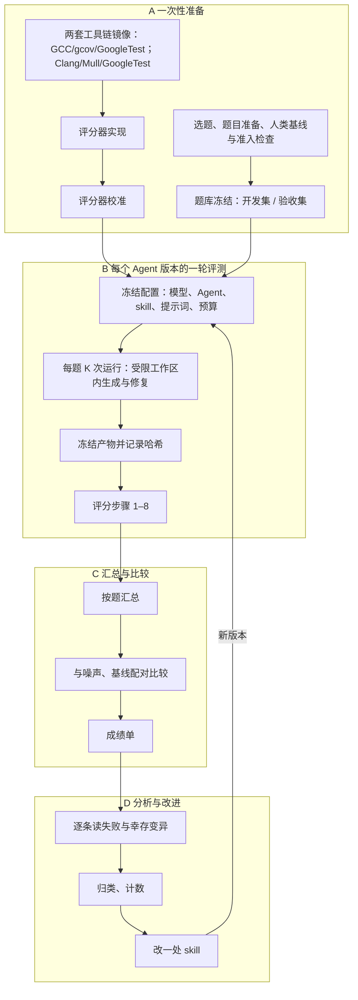

# 单元测试生成评测规格

> **v0.3 草案，2026-10-23。** 阶段 1 的目标卡完成后再冻结为 v1（见[项目推进流程](项目推进流程.md)）。本文规定的评测能力**大部分尚未实现**，实现状态见第 6 节。评分器和校准样本怎么实现，见[评分器与校准样本设计](评分器与校准样本设计.md)；设计理由见[评测与改进建议](大模型生成C++单元测试的评测与改进建议.md)；已定决定见[决策记录](决策记录.md)。
>
> 版本变化：
> - v0.2 新增：选题标准、已有测试的可见性与强度确认、人类基线（H1）、真实缺陷检出率（M4）、断言写错的校准样本。
> - v0.3（D002）：去掉 sanitizer、极端变异和静态扫描，以及对应指标 M3、F2、A1、A2；手写变异、真实缺陷、等价版本合并为通用的“替换版本执行”步骤；新增第一版范围、预留字段、评分器版本与补评规则。

## 1. 评测对象与范围

- **评测对象**：一个“Agent 版本”，即模型、Agent 框架、skill、提示词的组合。给它一份已有的 C++ 代码，它全自动生成 GoogleTest 单元测试。
- **评的是什么**：Agent 生成的测试文件，以及生成过程的成本。
- **断言依据**：以被测代码的实际运行结果为准（D001）。Agent 需要能在沙箱里编译、运行目标代码。
- **不评什么**：
  - 代码是否符合需求，由后续功能测试负责；
  - 代码风格这类主观项，只做人工抽查，不计分；
  - 被测代码本身是否正确，因此题库不需要“确定正确的代码”。
- **基本单位**：一道**题目**是一段被测代码及其配套材料；Agent 对一道题做一次完整的生成（含预算内的修复），称为一次**运行**。每道题跑多次运行，成绩按题汇总。

## 2. 测评内容

| 编号 | 内容 | 回答的问题 | 地位 |
|---|---|---|---|
| 一 | 有效性 | 生成的测试能不能用：编译得过、真的执行、在被测代码上通过 | 门槛：不过关的测试不参与后面的评分 |
| 二 | 稳定性 | 同一份测试反复跑、换顺序跑、单独跑，结果是否一致 | 门槛 + 守护指标 |
| 三 | 缺陷检出能力 | 代码被改坏时，测试能不能发现 | **主指标** |
| 四 | 抗误报能力 | 代码没被改坏（行为等价的改写）时，测试会不会失败 | 守护指标 |
| 五 | 覆盖率 | 测试执行到了哪些代码 | 诊断指标 |
| 六 | 成本与效率 | 花了多少 token、时间、修复轮次 | 守护指标 |

各层的用法：
- **门槛**决定一个测试或一次运行有没有资格参评。
- **主指标**用于比较 Agent 版本的好坏。
- **守护指标**要求在主指标提高的同时不能变差。
- **诊断指标**只用来解释原因，不单独下结论。

## 3. 测评方法

### 3.1 评测环境

- 全部评分在 Docker 容器内完成：禁网，源码只读挂载，资源受限，命令和输出全程审计（沿用 `audit.py` 的机制）。
- 镜像在构建阶段装好固定版本的工具链，评测容器内不联网下载。需要的工具：GCC、gcov、GoogleTest、Clang、Mull。
- 语言标准固定为 **C++11**。已落地版本为 GCC/gcov **14.2.0**、GoogleTest **1.12.1**、Clang/LLVM **19.1.7**、Mull **0.34.2**；镜像定义、使用方法与容器验收证据见 [C++11 固定工具链](C++11固定工具链.md)。
- **同一份源码分两套构建：**
  - **GCC 构建**：运行测试、统计 gcov 覆盖率、检查稳定性、执行替换版本。
  - **Clang 构建**：只用来跑 Mull 变异测试。

  两套构建编译的是同一份源码，只要代码不依赖未定义行为或编译器特有行为，变异结论在 GCC 下同样成立。
- 生成的测试**单独**构建、单独运行，不和目标仓库已有的测试混在一起。每次运行前清空覆盖率数据。需要评估“补充测试带来的增益”时，分别运行已有测试、生成测试、两者合并，三组分开统计。

### 3.2 题目来源与准备（每道题一次性完成，随题目冻结）

**选题标准**：优先选同时满足以下条件的 C++ 仓库或模块：

- 有现成的单元测试，可作为参考强测试集和人类基线的来源；
- 能用 GCC 和 Clang 两套构建编译，已有测试能跑通；
- 有缺陷修复历史，可从中构造真实缺陷题。

验收题尽量用模型没见过的代码，例如内部仓库，或者模型训练截止之后才提交的代码。公开仓库里已有的测试可能被模型见过，只适合作开发题，或者作参考与基线。

每道题要准备的材料：

| 材料 | 说明 | 对被测 Agent |
|---|---|---|
| 被测代码与可见上下文 | 源码、头文件、构建方式；指明被测的源文件或函数 | 可见 |
| 评分输入域 | 评分器参考实现保证与被测代码一致的输入范围 | 不可见 |
| 预算 | token、时间、修复轮次的上限 | 可见 |
| 已有测试 | 目标仓库自带的单元测试 | 默认不可见。若生产场景是“在已有测试上补充”，设为可见并写进题目卡；可见与不可见两种设置的成绩分开比较 |
| 参考强测试集 | 人写的或经人工审核的高质量测试，用来确认题目可解、标定变异分母。可以来自已有测试，但要先通过强度确认（见准入检查） | 不可见 |
| 变异分母 | 用参考强测试集跑一次 Mull；幸存的变异由人判定是否等价，等价的剔除。之后所有 Agent 版本都用这同一个分母 | 不可见 |
| 人类基线 | 用第 3.4 节的同一套评分步骤给已有测试打分的结果，作为 H1 指标 | 不可见 |
| 替换版本列表 | 每个版本是被测源文件的一份替换，标注类型和期望，见下表。**题目格式里始终保留这一栏，第一版可以为空** | 不可见 |
| 来源记录 | 项目、提交、文件哈希；开发集或验收集 | 不可见 |

替换版本的三种类型：

| 类型 | 内容 | 期望 | 规模与优先级 |
|---|---|---|---|
| 真实缺陷 | 一次真实缺陷修复的修复前代码；被测代码使用修复后的版本 | 测试应当失败 | 第二优先：验收集中 3–5 道题 |
| 等价版本 | 行为与被测代码一致的改写，用参考强测试集和差分测试确认 | 测试应当通过 | 第三优先：2–3 道开发题 |
| 手写变异 | 针对重点风险手写的变异 | 测试应当失败 | 按需添加 |

题目入库前要通过**准入检查**：
- 参考实现能用两套构建分别编译；
- 参考强测试集稳定通过；
- 参考强测试集的强度已确认：用 Mull 量出的变异检出率达到要求（阈值待定，见第 7 节）；来自已有测试而不达标的，人工补强后再用；
- 变异分母已标定；
- 每个替换版本都能用 GCC 构建编译；参考强测试集在“应当失败”的版本上失败，在等价版本上通过；
- 隐藏材料已经与 Agent 的工作区隔离；
- 最简单的基线提示词不会全对，也不会全错。

### 3.3 生成

- Agent 在受限工作区里运行：只能看到“可见”材料，看不到评分输入域、变异、参考测试、替换版本和历史评分。
- 首次生成的产物和每一轮修复的产物分别保存，并记录每一轮的 token、耗时、编译与运行结果。
- 预算用完或 Agent 声明完成时，冻结最终产物，记录哈希，然后才进入评分。

### 3.4 评分步骤

每次运行的产物按下面的顺序评分。前一步没过的，后面相应地不评或记零，原因要记录下来。

| 步骤 | 做什么 | 工具 | 对应内容 | 第一版 |
|---|---|---|---|---|
| 1 构建 | 用 GCC 编译、链接生成的测试 | CMake、GCC | 有效性 | 做 |
| 2 发现与执行核对 | 列出测试，运行并输出 JSON 结果，核对发现数、执行数、跳过数、禁用数 | `--gtest_list_tests`、`--gtest_output=json` | 有效性 | 做 |
| 3 被测代码上通过 | 所有执行的测试都应通过；失败或崩溃的测试判为写错，记入无效 | GoogleTest | 有效性 | 做 |
| 4 稳定性 | 重复运行 N 次；按 S 个随机种子打乱顺序运行；每个测试单独运行一次。结果不一致的测试判为不稳定，排除出后续评分并计数 | `--gtest_repeat`、`--gtest_shuffle`、`--gtest_filter`，自写脚本 | 稳定性 | 做 |
| 5 覆盖率 | 只统计指定的被测源文件 | gcov（文本与 JSON） | 覆盖率 | 做 |
| 6 变异测试 | 用 Clang 构建跑 Mull，只用通过前面所有门槛的测试 | Mull | 缺陷检出能力 | 做 |
| 7 替换版本执行 | 对替换版本列表中的每个版本：用它替换被测源文件，重新编译，运行有效测试，记录每个测试是通过还是失败。按版本期望计算 M2、M4、F1；版本上编译失败的单列 | 通用执行器 | 缺陷检出能力、抗误报能力 | 实现接口；列表为空时跳过 |
| 8 成本 | 汇总生成阶段记录的 token、耗时和修复轮次 | 生成记录 | 成本与效率 | 做 |

步骤 7 是一个通用动作，之后补充真实缺陷题和等价版本，只需往题目里增加版本文件、填写版本列表，评分器不用改。

### 3.5 变异测试的口径

- **分母**：Mull 生成的变异，减去两类：题目准备时判定的等价变异，以及在 Clang 构建下编译失败的变异。
- **分子**：被至少一个有效测试杀死的变异。
- **没被覆盖到的变异**算“未检出”，进分母、不进分子。
- **超时**：单独计数，不进分子、也不进分母，报告里写明数量。超时偏多时要排查。
- **手写变异**：通过步骤 7 执行，单独报告为 M2，不并入主指标。
- **可比性**：Mull 的版本和变异算子配置随题目冻结；不同 Agent 版本必须使用同一套配置和同一个分母。

### 3.6 运行次数与统计

- **每道题跑 K 次运行**，初始值 K = 5。所有 Agent 版本跑同一批题、同样的次数。
- **先测噪声**：同一个 Agent 版本重复评测，看主指标自然波动多大。
- **比较两个版本**：按题配对比较，用按题聚类的两层配对 bootstrap 计算差值的置信区间；二值指标可用 McNemar 检验作补充。具体步骤见[评分算法](评分算法.md)第 6 节。
- 主指标、想分辨的最小差异、K、N、S 都在正式比较之前写定，不允许跑几次挑最好的那次。

### 3.7 评分器校准

评分器每次修改，都要先跑校准样本，结果符合预期才能用于正式评测。校准样本覆盖以下几类，具体清单、期望结果和通过标准见[评分器与校准样本设计](评分器与校准样本设计.md)第 9–11 节：

- 应判无效的测试：空测试、全部跳过、自带 `main`、提前退出、断言值写错、运行时崩溃；
- 应判不稳定的测试：顺序依赖、结果随机；
- 应得低分的测试：只调用不断言、把断言宏定义为空、只检查部分输出；
- 应得高分的测试：参考强测试集；
- 替换版本接入后启用：写死实现细节的测试应在等价版本上误报，强测试应在修复前的版本上失败。

### 3.8 评分器版本与补评

- **评分器带版本号**，每份结果都记录评分器版本和校准结果。只在同一版本的评分器下比较成绩。
- **补评**：Agent 生成的最终测试已冻结并记录哈希。新增或修改评分步骤后，可以用新版本评分器重新评历史上冻结的测试，不需要 Agent 重新生成。比较不同时期的成绩前，先用同一版本统一重评。
- 新增步骤只增加指标，不改动已有指标的口径；需要改口径时，升评分器版本，并在版本说明里写明影响。

## 4. 测评指标

每个指标在单份产物上怎么计数、怎样汇总到题目和题库，见[评分算法](评分算法.md)。

“层”一列：门 = 门槛，主 = 主指标，守 = 守护指标，诊 = 诊断指标，参 = 参照值（不参与判定）。

| 编号 | 指标 | 定义 | 层 | 备注 |
|---|---|---|---|---|
| V1 | 编译通过率 | 测试能编译、链接的运行数 ÷ 总运行数 | 守 | 首次与修复后分别报告 |
| V2 | 有效运行率 | 通过步骤 1–3、且至少剩一个有效测试的运行数 ÷ 总运行数 | 守 | 首次与修复后分别报告 |
| V3 | 无效测试占比 | 步骤 2–3 判为无效的测试数 ÷ 生成的测试总数 | 门 | 按原因分类：未执行、跳过、禁用、在被测代码上失败、崩溃 |
| S1 | 不稳定测试占比 | 步骤 4 判为不稳定的测试数 ÷ 通过步骤 1–3 的测试数 | 守 | |
| S2 | 失败复现率 | 对不稳定测试：重复运行中失败的次数 ÷ N | 诊 | 越接近 0 或 1，越容易定位；中间值说明时好时坏 |
| M1 | 变异检出率 | 被杀死的变异数 ÷ 有效变异数（口径见 3.5） | **主** | 报告两个数：无效运行记 0 的“端到端”值，以及只算有效运行的值。比较版本时以预算内修复后的端到端值为准 |
| M2 | 手写变异检出率 | 步骤 7 中被检出的手写变异数 ÷ 手写变异总数 | 守 | 不并入 M1；没有手写变异的题目不统计 |
| M4 | 真实缺陷检出率 | 步骤 7 中在修复前版本上被检出的有效运行数 ÷ 真实缺陷题的有效运行数 | 守 | 至少一个有效测试失败（断言失败或崩溃）即为检出；修复前版本上编译失败的运行单列。不并入 M1 |
| F1 | 误报率 | 步骤 7 中在至少一个等价版本上失败的有效测试数 ÷ 有效测试数 | 守 | 只在有等价版本的题目上统计 |
| C1 | 行覆盖率 | gcov 统计的被测源文件已执行行数 ÷ 可执行行数 | 诊 | 只统计指定的被测源文件，说明分母 |
| C2 | 分支覆盖率 | 已执行的分支数 ÷ 分支总数 | 诊 | 同上 |
| C3 | 函数覆盖率 | 被调用过的被测函数数 ÷ 被测函数总数 | 诊 | 单元测试中通常很高，区分度低 |
| C4 | 增量覆盖 | 生成测试与已有测试合并后的覆盖，减去已有测试单独的覆盖 | 诊 | 只在目标仓库已有测试时统计 |
| K1 | 成本 | 每次运行的 token、耗时、模型调用次数、修复轮次 | 守 | |
| H1 | 人类基线 | 已有测试按同一套评分步骤得到的 M1、C1、C2、F1 等 | 参 | 在成绩单中与 Agent 的成绩并列；只在有已有测试的题目上统计 |
| R1 | 可读性 | 人工抽查命名、结构、失败信息能否定位问题 | 诊 | 两人独立打分并计算一致性，不计分 |

M3、F2、A1、A2 在 v0.3 中按 D002 删除，编号不再复用。

报告时区分以下几种计数，不能混用：题目数、运行数、测试函数数、断言数、变异数。

**判定规则**：一个新版本算“更好”，要同时满足：
- M1 的配对差异超过事先写定的最小差异，且置信区间不含 0；
- V2、S1、K1 没有超出事先写定的容忍范围；
- 已接入的 M2、M4、F1 也没有超出容忍范围。

## 5. 总体测评流程

**A. 一次性准备**（评分器或题库变化时重做）
1. 构建工具链镜像，固定所有工具的版本。
2. 对每个目标仓库先做一次 Clang 构建适配：用 Clang 编译、跑通已有测试，记下需要调整的构建选项（例如关闭 `-Werror`、按编译器区分专有选项）。
3. 实现第 3.4 节的评分步骤，用第 3.7 节的样本完成校准。
4. 按第 3.2 节的选题标准选题、准备材料，用同一套评分步骤给已有测试打分作为人类基线，通过准入检查后冻结。开发集用于调试，验收集只在发布候选版本时运行。

**B. 一轮评测**（每个待测的 Agent 版本）
1. 冻结并记录配置：模型、Agent、skill、提示词、工具链版本、预算。
2. 对每道题跑 K 次运行，每次在全新的受限工作区里生成与修复，保存每一轮产物。
3. 冻结最终产物、记录哈希后，按评分步骤 1–8 打分，每次运行输出一份结构化结果。

**C. 汇总与比较**
1. 先按题汇总，再跨题汇总；首次与修复后分开。
2. 与噪声、基线版本按第 3.6 节配对比较，按第 4 节的判定规则下结论。
3. 输出成绩单：门槛和守护指标各项、主指标及其区间、诊断指标，与人类基线（H1）并列，并写明评分器版本和尚未验证的部分。

**D. 分析与改进**
1. 逐条读无效测试、不稳定测试、幸存变异和误报的原始记录，归类、计数。
2. 选占比最高的一类，改一处 skill，形成新版本，回到 B。迭代只用开发集。

结果目录与文件格式见[评分器与校准样本设计](评分器与校准样本设计.md)。

## 6. 实现状态

| 能力 | 状态 |
|---|---|
| Docker 隔离、源码只读挂载、审计日志 | 已实现并验证（当前 C++11 工具链验收） |
| C++11 固定版本 GCC/gcov/GoogleTest 与 Clang/Mull 镜像 | 已实现并在 Linux ARM64 容器中验收；见 [工具链说明](C++11固定工具链.md) |
| 测试生成入口、受限工作区 | 待实现 |
| 评分器：步骤 1–8（`gildedrose-lab/scorer/`，见[评分器与校准样本设计](评分器与校准样本设计.md)） | **已实现**。单元测试与宿主机集成测试通过（不含 gcov、Mull）；Docker 容器中的完整校准待执行，见[评分器运行说明](评分器运行说明.md) |
| gcov 多源文件与函数覆盖 C1–C3 | 已实现；解析已用真实 gcov 输出验证，容器内采集待校准确认 |
| 增量覆盖 C4、人类基线 H1 | 未实现；GildedRose 题目没有可用的已有测试 |
| 变异分母标定（参考强测试集 + 有界穷举探针，等价候选人工复核） | 已实现（`prepare_task.py`）；GildedRose 的分母待在 Docker 中标定 |
| 替换版本执行与 M2、M4、F1 | 已实现；GildedRose 有 1 个等价版本 eq-01、1 个手写变异 hw-01，宿主机检查通过；尚无真实缺陷题 |
| 评分器版本、校准状态指纹与补评 | 已实现 |
| 评分器校准样本 | 已实现 16 个（CAL-01 至 CAL-16），宿主机检查通过；容器校准待执行；CAL-18 待有真实缺陷题后添加 |
| 题库：开发集与验收集 | 题目包格式已实现；目前只有 GildedRose 一道开发题，尚未按第 3.2 节的选题标准选题，没有验收题 |
| 汇总、配对比较与成绩单 | 已实现（`aggregate.py`），已用构造数据验证；尚无真实评分结果 |

## 7. 待定事项

1. 生产环境能否给 Agent 提供目标项目的构建环境（D001 的前提）。
2. 目标仓库的 Clang 构建适配结果。
3. 参数初始值：K = 5、N = 10、S = 3，在测出噪声后调整。
4. M1 的最小有意义差异，以及各守护指标的容忍范围。
5. 参考强测试集由谁编写、谁审核；等价变异由谁判定。
6. 参考强测试集强度确认的阈值：Mull 变异检出率达到多少才可用。
