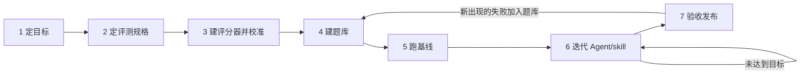

# 项目推进流程

> 回答两个问题：整件事按什么顺序做，每一步做到什么程度才算完成。评测具体怎么设计，见[评测与改进建议](大模型生成C++单元测试的评测与改进建议.md)。

## 为什么会觉得乱

“做一步看一步”，通常是缺了三样东西：

1. 每一步没有“做完”的标准，不知道什么时候该停、该进入下一步。
2. 新发现的问题直接插队，计划不断被打断。
3. 没有一个固定的地方记录“现在在哪、下一步做什么”。

下面的流程给每一步都定了产出和过关标准，再用几条纪律来处理插队和记录。

## 方法

三条原则，都有成熟的出处：

1. **先造尺子，再造 Agent。** 评测集和评分器先于 Agent 和 skill 完成，再用评测结果驱动改进（Anthropic 的 agent 评测指南称之为 eval-driven development）。你“先搭评测、再做 Agent”的思路是对的，缺的是每一步的完成标准。
2. **从目标推出指标。** 用 GQM（Goal–Question–Metric，Basili 等人提出）方法：先写“想达成什么”，再推出“要回答哪些问题”，最后才定“用什么指标回答”，避免先有指标、再找用途。ISO/IEC/IEEE 15939 规定的测量过程也是同一个思路：先策划测什么，再执行测量，最后评价测量本身是否有效。
3. **阶段关口（stage-gate）。** 每个阶段都有明确的产出和过关标准，不过关就不进入下一阶段。发现前面的阶段有问题，可以退回去改，但要记录下来。

## 全景



| 阶段 | 回答的问题 | 主要产出 | 过关标准 |
|---|---|---|---|
| 1 定目标 | 给谁用，怎样算成功，这一版不做什么 | 目标卡、决策记录 | 能一句话说清“用什么数字证明 Agent 变好了” |
| 2 定评测规格 | 测什么，标准答案从哪来，分母是什么 | 评测规格 v1、题目卡格式 | 每个指标都有定义、分母、数据来源和已知的作弊方式 |
| 3 建评分器并校准 | 尺子准不准 | 评分器、校准报告 | 校准顺序正确，作弊全部识别，结果可重复 |
| 4 建题库 | 用哪些题，怎样防止背题 | 开发集、验收集、准入记录 | 每道题都通过准入检查，验收集没参与过调试 |
| 5 跑基线 | 起点在哪，噪声多大，失败长什么样 | 基线成绩单、噪声估计、失败分类、比较方案 | 噪声已知，比较方案已冻结 |
| 6 迭代 | 哪个改动真的有效 | skill 各版本、实验记录 | 开发集上达到目标卡里的数字，或预算用完 |
| 7 验收发布 | 结论站得住吗 | 验收报告 | 验收集上的提升超出噪声，并至少有一项外部证据 |

## 当前位置（2026-10-24）

| 阶段 | 状态 | 说明 |
|---|---|---|
| 1 定目标 | 部分完成 | 总目标已明确；已定断言以被测代码的实际运行结果为准，需求符合性交给后续功能测试（[决策记录](决策记录.md) D001）；还缺使用场景、成功数字和其余“不做什么” |
| 2 定评测规格 | 草案 | [评测规格](评测规格.md) v0.3 已写出，待阶段 1 完成后冻结为 v1 |
| 3 建评分器并校准 | 已实现，待容器校准 | 评分器、题目包格式和 16 个校准样本已实现，单元测试与宿主机集成测试通过；变异分母标定和完整校准要在装有 Docker 的机器上执行（[评分器运行说明](评分器运行说明.md)第 2–4 步） |
| 4 建题库 | 只有一道开发题 | GildedRose 已整理为第一个题目包（参考强测试集、有界穷举探针、eq-01 和 hw-01 两个替换版本）；它是公开题，只作开发题；还没有验收题 |
| 5–7 | 未开始 | — |

阶段 3 的评分器已基于 [C++11 固定工具链](C++11固定工具链.md) 实现，过关还差一步：在 Docker 中完成校准（顺序正确、作弊全部识别、重复评分一致）。阶段 1、2 仍需补完，校准通过后再冻结评测规格 v1。

**下一步**：完成阶段 1 的目标卡，确认下面还待定的决定，然后进入阶段 2。每过一个关口，就更新这一节。

## 各阶段怎么做

### 阶段 1：定目标和范围

写一页目标卡，回答这几个问题：

- 生成的测试给谁用、用来做什么：例如重构前补测试保护现有行为，或者满足覆盖率门禁？
- 目标代码是什么样的：C++ 标准、构建系统、测试框架、代码规模、外部依赖？
- 这一版成功是什么样子：用哪个指标，比谁好多少？数字可以先写一个范围。
- 这一版不做什么？
- 每道题的预算是多少：token、时间、修复轮次？

已定的决定：

- 断言以被测代码的实际运行结果为准；代码是否符合需求，由后续功能测试负责，不属于本阶段（D001）。

还需要你确认的决定，括号里是建议：

1. 生产环境里，Agent 能不能拿到目标项目的构建环境，在沙箱里编译、运行代码？（D001 的前提，需要能）
2. 用什么测试框架？（GoogleTest）
3. GildedRose 的定位？（只作开发题）
4. Agent 最终服务谁的代码，自己的仓库还是开源项目？这决定了验收题从哪里来。

- **产出**：`docs/目标与范围.md`（一页）、`docs/决策记录.md`。
- **过关标准**：能用一句话回答“这一版做完时，用什么数字证明 Agent 变好了”；“不做什么”已经写下；你确认过。
- **常见的坑**：把目标写成“生成高质量测试”。这样既没法测量，也没法判断什么时候算做完。

### 阶段 2：定评测规格

1. 用 GQM 从目标推出问题和指标。比如目标是“生成的单元测试能保护代码的现有行为”：
   - 代码被改坏时，测试会报警吗？→ 最小非等价变异检出率
   - 代码没坏时，测试会误报吗？→ 等价重构误报率
   - 生成的测试能直接用吗？→ 首次有效率、修复后有效率
   - 测试稳不稳定、花费多少？→ 不稳定率；token、时间、修复轮次
2. 定题目卡的格式（模板见文末）。
3. 每个指标都写清楚：定义、分母、由谁来算、怎样会被钻空子、它是门槛还是主指标。
4. 只选一个主指标，并定下“最小有意义差异”，即差多少才值得保留一次修改。

- **产出**：`docs/评测规格.md` v1，带版本号和日期。
- **过关标准**：每个指标都能回答“分母是什么、怎样作弊能骗过它”；主指标和最小差异已经定下；规格冻结为 v1，之后的修改要升版本，并写明原因。
- **常见的坑**：先实现，再定指标。这样会不自觉地挑容易达标的指标。

### 阶段 3：建评分器并校准

1. 实现评分器：核对生成测试的构建和发现情况，接入重复与乱序运行、gcov、Mull 和替换版本执行，再给生成 Agent 准备受限的工作区。设计见[评分器与校准样本设计](评分器与校准样本设计.md)。
2. 准备校准样本，包括好坏已知的测试套件和作弊样本（清单见[评分器与校准样本设计](评分器与校准样本设计.md)第 10 节）。
3. 让仪器自检的结果和测试评分的结果分开输出。

- **产出**：评分器代码；校准报告，列出每个样本的期望结果和实际结果。
- **过关标准**：校准顺序正确；作弊全部识别；同一套件评两次，结果完全一致；在 Docker 容器内跑通。
- **常见的坑**：用旧规则测试“全部通过”来证明评分器可用。旧测试从来不会触发评分器判“失败”的那些分支。

### 阶段 4：建题库

1. 开发集：GildedRose，再加一道改名、改阈值、改常量的孪生题。
2. 验收集：至少一道真实缺陷的 C++ 题，来自 BugsC++、Multi-SWE-bench 的 C++ 部分等公开数据集，或者自己的仓库。验收题不参与任何调试，并尽量选在模型训练截止之后的提交。
3. 每道题都要通过准入检查：参考实现能构建；参考测试在基线上通过；变异有效；隐藏材料已隔离；最简单的基线不会全对，也不会全错。
4. 冻结题目，记录来源、提交和文件哈希。

- **产出**：开发集、验收集，以及每道题的题目卡和准入记录。
- **过关标准**：每道题都通过准入检查；验收集与开发集的来源相互独立。
- **常见的坑**：同一份代码换几组输入，就当成多道题；拿调试过的题来证明进步。

### 阶段 5：跑基线，测噪声

1. 用最简单的提示词（不带 skill）作为基线，每道题运行多次，例如 5 次。
2. 测噪声：同一配置运行多次，看分数波动有多大。
3. 做错误分析：逐条读生成的测试和过程记录，先开放式标注，再归类、计数，读到不再出现新类型为止。
4. 写比较方案：主指标、最小差异、每题运行次数、统计方法，以及保留还是回退的规则。

- **产出**：基线成绩单、噪声估计、失败分类 v1、比较方案。
- **过关标准**：噪声已知；失败分类来自真实记录，而不是事先想象出来的；比较方案已经冻结。
- **常见的坑**：只看总分，不读原始记录。

### 阶段 6：迭代 Agent/skill

每一轮都按同样的六步走：

1. 从失败分类里挑出占比最高、也最可能改好的一类。
2. 写下假设，例如“skill 加入边界值检查步骤后，‘边界不会测’这类失败会减少”。
3. 只改一处。
4. 按比较方案，在开发集上运行。
5. 差异超过噪声、其他类别也没有变差，就保留这次修改；否则回退。
6. 写实验记录（模板见文末）。

迭代期间不运行验收集。

- **产出**：skill 的各个版本、实验记录。
- **退出条件**：开发集上达到目标卡里的数字，或者预算用完。
- **常见的坑**：一次改好几处，不知道到底是哪一处起了作用；跑几次挑最好的那次。

### 阶段 7：验收与发布

1. 冻结候选版本：模型、Agent、skill、提示词、工具链。
2. 按比较方案在验收集上运行，报告完整的成绩单：首次生成与修复后的成绩、各项指标、稳定性、成本。
3. 至少做一项外部验证：人工盲评抽查、维护者采纳，或者在另一台机器上复现。
4. 用过的验收题转入开发集，再补充新的验收题。已经稳定全对的题，转成防退步题集，每次修改 skill 都跑一遍。

- **产出**：验收报告、发布记录。
- **过关标准**：和基线相比，差异超出噪声；至少一项外部验证通过；报告里写明哪些部分尚未验证。
- **之后**：真实使用中出现的失败加入题库，回到阶段 5 和 6。

## 贯穿始终的纪律

1. **只在一个地方记录“现在在哪”**：就是本文的“当前位置”一节，每过一个关口更新一次。
2. **新发现要分流**：挡住当前关口的问题立即处理；不挡的先放进待办池，等阶段复盘时再排序。不要因为有了新想法就跳阶段。
3. **决策要记录**：写下日期、决定、理由，以及放弃了哪些选项。已经定下的事不反复重议，除非出现了新证据。
4. **探索和正式运行分开**：探索性的运行可以随意跑，但不能拿来下结论；正式运行要先登记方案，再执行。
5. **一切都有版本号**：评测规格、评分器、题库都带版本号。改了评分器要重跑校准；改了题库要重跑基线。
6. **一次只改一个变量。**
7. **每个阶段结束时复盘一次**：过关标准是否都满足了，待办池怎么排，要不要退回前面的阶段。

## 模板

### 题目卡

```text
编号：            来源：项目 / 提交 / 文件哈希            集合：开发 / 验收
目标代码与可见上下文：
评分输入域：
测试框架：        允许修改的文件：        构建与运行方式：
生成与修复预算：
隐藏材料：评分用变异、参考答案、参考测试
准入检查：参考实现构建 / 参考测试通过 / 变异有效 / 已隔离 / 基线不饱和
```

### 实验记录

```text
日期：        编号：        阶段：
假设：
改动（只改一处）：
配置：模型、Agent、skill、提示词、工具链版本、预算
运行：题库版本、每题运行次数
结果：主指标及区间、守护指标、与噪声的比较
结论：保留 / 回退 / 需要更多数据
原始记录位置：
```

## 参考

- [The Goal Question Metric Approach](https://www.cs.umd.edu/~mvz/handouts/gqm.pdf)（Basili、Caldiera、Rombach，1994）
- [ISO/IEC/IEEE 15939:2017 测量过程](https://webstore.iec.ch/publication/60751)
- [Demystifying evals for AI agents](https://www.anthropic.com/engineering/demystifying-evals-for-ai-agents)（Anthropic，2026）
- [错误分析：开放式标注与归类](https://hamel.dev/blog/posts/evals-faq/why-is-error-analysis-so-important-in-llm-evals-and-how-is-it-performed.html)（Hamel Husain）
- [Adding Error Bars to Evals](https://arxiv.org/abs/2411.00640)（Miller，2024）
