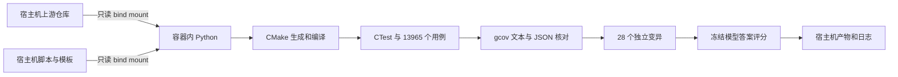

# GildedRose Docker 自动化与复杂分支推理实验报告

本报告已按后续要求更新为仅保留上游 `cpp/` 文件夹，当前成功轮次为 `cpp-only-20261021`。上一轮及本轮的完整测试闭环都实际运行在 Docker 中；Python、CMake、GCC、CTest、gcov 和变异检测均在容器内执行。源码位于宿主机，通过只读目录挂载引入镜像外的文件。其他语言目录已经从工作目录和交付 ZIP 中移除。

**13,965 是对同一份 C++ 实现生成的输入组合记录数，不是源码文件数，也不是跨语言测试总数。** 上游业务目标是 `cpp/src/GildedRose.cc` 的 `GildedRose::updateQuality()`；`.cc` 是上游采用的 C++ 文件扩展名，按你的要求保留整个 `cpp/` 文件夹，没有更改扩展名。本轮删去其他语言目录后，C++ 输入矩阵没有变化，所以数量仍为13,965。Python 文件是运行闭环所必需的调度和解析脚本。

容器内已完成“生成 → 编译 → 测试 → 解析覆盖率 → 独立注入 Bug → 统计检出率”，并重放事前冻结的当前对话模型答案进行评分。下表为本次复跑实测结果，原始证据均可直接打开。

| 验证项 | 实测结果 | 证据 |
| --- | --- | --- |
| 源码获取 | d6407909c73b2ba61bfa7568af0d9bdce1902fd5 | [宿主机 cpp 目录](../external/GildedRose-Refactoring-Kata/cpp) |
| 上游测试范围 | 仅 cpp/；未编译其他语言目录 | [实际编译文件清单](../runs/cpp-only-20261021/source_scope.json) |
| 源码引入方式 | 只读 bind mount；构建上下文只有 docker/ 文件 | [挂载证据](../artifacts/cpp-only-20261021/container-inspect-before.json) |
| Python → CMake → CTest | 完成生成、编译及3项 CTest（其中合同测试内部执行13,965例） | [test_result.json](../runs/cpp-only-20261021/baseline/test_result.json) |
| 基线测试 | 13,965 / 13,965 通过 | [全部输入与 oracle](../runs/cpp-only-20261021/cases.json) |
| GildedRose.cc 行覆盖 | 29 / 29 = 100% | [GildedRose.cc.gcov](../runs/cpp-only-20261021/baseline/coverage/text/GildedRose.cc.gcov) |
| GildedRose.cc 分支覆盖 | 38 / 38 = 100%；文本与 JSON 完全一致 | [coverage.json](../runs/cpp-only-20261021/baseline/coverage/coverage.json) |
| 行为 Bug 检出 | 20 / 20 = 100% | [mutation_results.json](../runs/cpp-only-20261021/mutation_results.json) |
| 编译错误捕获 | 5 / 5 = 100%；均含源码位置与 GCC 消息 | [编译诊断示例](../runs/cpp-only-20261021/mutants/E01/result.json) |
| 链接错误捕获 | 1 / 1 = 100% | [result.json](../runs/cpp-only-20261021/mutants/E06/result.json) |
| 等价改动对照 | 2 / 2 正常通过，观察到0次误报 | [对照证据](../runs/cpp-only-20261021/mutants/C01/result.json) |
| 模型预测现有 GildedRose 行为 | 24 / 24 正确 | [rose_result.json](../runs/cpp-only-20261021/llm/rose_result.json) |
| 模型预测合成复杂分支 | 20 / 20 正确 | [scores.json](../runs/cpp-only-20261021/llm/scores.json) |
| 已知上游需求缺口 | Conjured 独立探针2例均与新需求不符，单列记录 | [known_spec_gap.json](../runs/cpp-only-20261021/known_spec_gap.json) |
| 最终退出状态 | 流水线 passed；Docker 容器退出0；约 30.24 秒 | [summary.json](../runs/cpp-only-20261021/summary.json) |

100% 行/分支覆盖率对应的是上游 `cpp/src/GildedRose.cc`；100% 变异检出率对应事前固定的20个行为变异；模型100%正确率对应本次44道具体问题。这三个分母不同，均不表示软件没有任何 Bug，也不表示模型能够正确处理所有复杂条件程序。

最初从 [GitHub 上游仓库](https://github.com/emilybache/GildedRose-Refactoring-Kata/tree/main) 的 main 分支浅克隆，再固定实际提交。本轮将工作树收敛为仅检出 `cpp/`；被测 [C++ 源码](https://github.com/emilybache/GildedRose-Refactoring-Kata/blob/d6407909c73b2ba61bfa7568af0d9bdce1902fd5/cpp/src/GildedRose.cc) 未修改，初始与最终 SHA-256 均为 `97958cdfb5c84c83263426c56080d30144867bc68871c2029ae8015741b197a6`，本机稀疏工作树运行前后 `git status --porcelain` 均为空。Python 负责调度和解析，不是本次 gcov 的被测语言。

保留的上游 `cpp/` 共 20 个文件，包括 C++ 源码、头文件、CMake 配置与说明。源码快照逐文件哈希见 [source_manifest.json](../external/source_manifest.json)。本机保留隐藏 `.git` 用于提交溯源；交付 ZIP 排除所有 `.git` 对象，以免携带其他语言的历史内容。上游许可证与需求说明另存于 [许可证](../notes/upstream/license.txt) 和 [需求说明](../notes/upstream/GildedRoseRequirements.md)。

以下是本轮 `compile_commands.json` 中的全部基线编译输入；前两轮也只编译同样的上游 C++ 文件。变异实验只修改 `GildedRose.cc` 的独立副本，额外模型压力题也是 C++，没有执行其他上游语言实现。

| 实际编译文件 | 角色 |
| --- | --- |
| /work/cpp-only-20261021/generated/probe.cc | 生成的 C++ 输入输出探针 |
| /repo/cpp/src/GildedRose.cc | 上游业务实现 |
| /repo/cpp/test/cpp_texttest/GildedRoseTextTests.cc | 上游 C++ 文本测试 |

| 环境项目 | 记录值 |
| --- | --- |
| 宿主机 | macOS / ARM64；宿主机 Python 3.13.3 |
| Docker | 客户端与 Engine 28.0.4；Docker Desktop 4.40.0 |
| 容器 | Debian 12 bookworm / Linux ARM64 |
| 容器工具 | Python 3.11.2；CMake 3.25.1；GCC/gcov 12.2.0；Ninja 1.11.1 |
| 镜像标签 | qualtor-gildedrose-toolchain:bookworm |
| 实测镜像 ID | sha256:a52e7bbe975b926f669674ff8d09a14965607083e0a8d2f37f5a850abcdd4f25 |
| 基础镜像 | debian:bookworm-slim@sha256:7ff6ba31527b9e336162fa061746c366c4b2032f4d2cff2078bea43f78efe3f8 |
| 运行限制 | 2 CPU、2 GiB 内存、256 PID；禁网、只读根文件系统、无附加 capabilities |
| 自动日志起点（北京时间） | 2026-10-21 18:30:55.455 |
| 成功容器运行（北京时间） | 2026-10-21 19:05:15.480 至 2026-10-21 19:05:45.715 |

基础镜像以 digest 固定，工具链包的实际版本另有 dpkg 清单。APT 软件仓库没有固定到历史快照，因此未来重新构建可能获得补丁更新，不能承诺未来镜像逐字节相同；当前已构建镜像可直接用 `--skip-build` 复用。

容器挂载关系如下。源码和脚本都在镜像外，构建、覆盖文件、变异副本及日志也持久化到宿主机。

| 宿主机目录（相对实验目录） | 容器目录 | 属性 |
| --- | --- | --- |
| external/GildedRose-Refactoring-Kata | /repo | 只读 |
| /Volumes/Data/ProjectCode/Qualtor/gildedrose-lab | /lab | 只读 |
| runs | /work | 可写 |



这一实现遵循 [Docker bind mounts](https://docs.docker.com/engine/storage/bind-mounts/) 的宿主目录挂载方式。Dockerfile 没有复制项目的指令，构建命令的上下文明确指定为 `gildedrose-lab/docker`，`.dockerignore` 仅允许 Dockerfile 和过滤规则。镜像历史、创建容器时的 Mounts 信息以及“不挂载时 /repo 和 /lab 均不存在”的实际探针一并保留，见 [image-history.txt](../artifacts/cpp-only-20261021/image-history.txt)。

Python 使用参数数组调用子进程，不通过 shell 拼接业务命令。每条命令记录开始/结束时间、工作目录、退出码、超时、stdout、stderr；执行探针时另存 stdin。超时会终止该子进程组。CMake 采用源码外构建：先 `cmake -S ... -B ... -G Ninja`，再 `cmake --build ... --parallel 2`，最后运行 CTest。这些命令用法对应 [CMake CLI 文档](https://cmake.org/cmake/help/latest/manual/cmake.1.html)。

基线包装项目复用上游 CMake 的 GildedRoseLib 和文本测试，关闭四个会下载 GoogleTest/Catch2 的选项，再加入空库存测试与生成的合同测试。上游单元测试里存在故意写成 `EXPECT_EQ("fixme", ...)` 的占位断言，所以本报告不声称原仓库默认所有测试已通过。CTest 的3项为本实验空库存测试、13,965例合同测试和上游文本测试；文本测试的成功退出本身不等同于业务断言。

测试 oracle 使用独立的分段规则描述普通商品、Aged Brie、Backstage passes 和 Sulfuras 的每天变化，未照抄原始嵌套 if-else。Conjured 在“现有行为”基线中按普通商品处理，另设“新需求”探针。测试还包含名称尾随空格，以核对代码使用精确字符串匹配。

| 测试组 | 用例记录数 | 单独检出的行为变异 | 该组检出率 |
| --- | --- | --- | --- |
| smoke | 5 | 7/20 | 35% |
| boundary | 1440 | 20/20 | 100% |
| bounded_exhaustive | 11520 | 20/20 | 100% |
| seeded_holdout | 1000 | 19/20 | 95% |

数量构成为：冒烟5条；边界组 `(5个非Sulfuras名称 × 7个质量值 + Sulfuras的1个质量值) × 8个销售日 × 5个运行天数 = 1,440`；有界穷举组 `(5 × 51 + 1) × 15个销售日 × 3个运行天数 = 11,520`；固定随机组1,000条。合计 `5 + 1,440 + 11,520 + 1,000 = 13,965`。每条输入包含商品名、sellIn、quality 和运行天数，分别断言这份 C++ 实现的输出。

四组共有13,965条用例记录，互异输入组合为 13,187 个；组间有重复，报告没有把记录数当作独立样本数。边界组围绕销售日 -3、-1、0、1、5、6、10、11 与质量0、1、2、47、48、49、50，分别执行0、1、2、5、10天。Sulfuras 使用合法质量80。有界穷举覆盖销售日 -2至12、质量0至50以及1/2/5天；固定随机组 seed 为20261021，覆盖更宽销售日与0至60天。

测试生成规则与变异清单在运行前落盘并记录 SHA-256。本次只靠5个冒烟用例能检出7/20；边界组和有界穷举组都检出20/20；固定随机组检出19/20，遗漏 M18（门票接近质量上限时的条件错误）。这说明边界输入对这组缺陷有实际贡献。测试用例详情见 [cases.json](../runs/cpp-only-20261021/cases.json)，全部变异详表见 [变异明细](变异明细.md)。

覆盖编译使用 `-O0 -g --coverage -fprofile-abs-path`，先执行基线，再保存 `.gcda/.gcno` 原始快照。Python 分别调用 `gcov -b -c` 和 `gcov -b -c -j`，解析 `.gcov` 与 `.gcov.json.gz`，只统计匹配目标源码文件的数据，并核对可执行行数、命中行数、分支数与命中分支数。选项和 JSON 格式参考 [GCC gcov 文档](https://gcc.gnu.org/onlinedocs/gcc/Invoking-Gcov.html)；本次实测版本为 GCC 12.2.0 / JSON format 1。

目标文件有29个 gcov 可执行行、38条分支边，全部命中。这里的“行”不是源文件物理行数，分支覆盖不是路径覆盖或 MC/DC。标准库、测试探针和合成压力程序没有混入该100%业务覆盖指标；本次该源码没有额外 throw 分支，原始分支与剔除 throw 后的计数相同。原始覆盖快照在 [coverage/raw/](../runs/cpp-only-20261021/baseline/coverage/raw)，后续探针运行不会改写它。

每个 Bug 都从同一份原始源码独立生成，保存补丁和前后哈希，使用独立构建目录。行为变异只有在编译成功、探针返回成功、输出协议有效而断言不匹配时才记为 killed；构建失败、超时或输出损坏不会被误算成行为 Bug 检出。行为检出率为 `20 / 20 = 100%`。两个等价变异（循环后置递增改前置递增、自身相减改零）均 survived，作为无行为变化的对照；两个样本的零误报不应外推成总体零误报率。

编译错误使用 GCC JSON 诊断提取消息和文件/行/列。因为 Ninja 可能把编译器输出放到构建 stdout，解析器同时检查 stdout 与 stderr。链接错误通过独立的 undefined reference 分类捕获。六个负向构建均返回1，均捕获到了预期阶段的诊断，且测试脚本继续处理后续变异。

| 编号 | 注入错误 | 构建返回码 | 源码行 | 捕获消息 |
| --- | --- | --- | --- | --- |
| E01 | 语法错误：缺少分号 | 1 | 18 | expected ';' before '}' token |
| E02 | 成员错误：不存在的字段 | 1 | 18 | '__gnu_cxx::__alloc_traits<std::allocator<Item>, Item>::value_type' {aka 'class Item'} has no member named 'missing_quality' |
| E03 | 类型错误：字符串赋给整数 | 1 | 18 | invalid conversion from 'const char*' to 'int' |
| E04 | 头文件错误：不存在的 include | 1 | 1 | Missing_GildedRose.h: No such file or directory |
| E05 | 返回类型错误：void 返回整数 | 1 | 10 | return-statement with a value, in function returning 'void' |
| E06 | 链接错误：缺少函数实现 | 1 | 5 | /work/cpp-only-20261021/mutants/E06/source/GildedRose.cc:5: undefined reference to `missing_hook()' |

上游需求缺口单独测得：`Conjured Mana Cake` 在 sellIn=3、quality=6 时一天后实际 quality=5，新需求应为4；在 sellIn=0、quality=6 时实际为4，新需求应为2。此结果说明当前原始实现尚未支持新功能，既不混入本实验行为变异分母，也没有通过修改上游代码隐藏它。

大模型部分按你的选择使用当前对话模型。题目生成器只写源码和问题，不计算答案；模型只读题目与源码后作答。最终题目含24个原仓库多日边界问题，以及12个条件树问题、8个深层状态更新问题。冻结前补充了4个负余数入口问题，未执行的初版也已保留。

答案于北京时间 2026-10-21 18:44:17.838 冻结，SHA-256 为 `65db1e8cda8187ad255afa5f4450ef18da7de6407899b1cc3c501384b3152f48`。评分前逐个核对题目、源码、协议和预测文件哈希；此后才调用 C++ 可执行程序取得答案。题目 ID 不允许缺失、重复或多出。原始答案见 [predictions.json](../benchmark/predictions.json)，冻结记录见 [freeze.json](../benchmark/freeze.json)，逐题输入/预测/实际值见 [模型盲测逐题结果](模型盲测逐题结果.md)。

| 模型测试对象 | 题数 | 正确 | 准确率 |
| --- | --- | --- | --- |
| 原仓库行为 | 24 | 24 | 100% |
| 合成条件树 | 12 | 12 | 100% |
| 合成深层状态更新 | 8 | 8 | 100% |
| 合计 | 44 | 44 | 100% |

合成源码有 404 个物理行、91个 if、115个逻辑 &&/|| 运算符，最大 if 嵌套22层。tree 函数有31个 if，deep 函数有60个 if 和20级连续门控；不计短路运算的逐函数圈复杂度为32和61。D01、D02 走完20级门控，D06 在最深层走入两级回退条件。涉及负数取模、短路条件、位掩码、嵌套返回和逐级更新状态。合成代码是额外压力题，不冒充上游仓库原有代码。

这20个合成输入对应的实际覆盖率只有 **97/214 行 = 45.33%，149/442 分支 = 33.71%**；剔除 throw 分支后为149/430 = 34.65%。合成器还可能产生相关或不可达条件。因此本次结果只能支持“模型答对了这些给定输入”，不能支持“所有深层分支均已验证”。题目作者和答题者处于同一会话，且 GildedRose 是公开 kata，这是一轮有限自测，不是独立第三方模型评测；没有多模型、多采样或独立随机种子对照，运行时也没有可核验的精确模型快照。

本次全过程包含真实失败及修复：Docker 沙箱套接字受限；默认凭据助手阻塞；独立 Docker 配置初次未发现 Buildx；APT 单个软件包下载 HTTP 500；首轮容器执行时日志事件 kind 参数冲突。收敛为 cpp/ 后第一次使用 --skip-build 时镜像标签不存在，随后按原 Dockerfile 成功重建并复跑；日志不足以判断标签此前为何消失。所有失败日志均保留。原因、修复与对应日志见 [实现与修复记录.md](../notes/%E5%AE%9E%E7%8E%B0%E4%B8%8E%E4%BF%AE%E5%A4%8D%E8%AE%B0%E5%BD%95.md)。本报告采用最新成功轮次 `cpp-only-20261021`，容器退出0，源码未变，实验容器已删除，工具链镜像保留供复用。

复现时在 Qualtor 根目录执行以下命令。首条包含镜像构建；镜像已存在时第二条可直接运行。默认使用新的时间戳目录，不覆盖历史运行。

```bash
python3 gildedrose-lab/run.py
# 使用已构建的工具链
python3 gildedrose-lab/run.py --skip-build
```

重跑会生成测试与变异、运行全部构建/覆盖/检出流程，并重放已冻结的44份模型预测。**它不会自动产生新的模型回答，也不会发起模型 API 请求。** 要测新的模型，应建立独立题目和答案目录，重新执行“先提交答案、冻结、再评分”的协议。本次 Python 无第三方依赖；Docker 首次构建需要访问公开镜像和 Debian 软件仓库，实验容器禁网。

从 ZIP 解压后也使用相同入口。附件包含上游 cpp/ 快照及固定提交、逐文件哈希；入口支持无 `.git` 的快照模式，先校验目录范围和全部源码哈希，再运行容器。任何源码被更改、缺失或增加，都会在编译前拒绝执行。

全量过程附件包含：上游 cpp/ 源码快照、最终脚本/模板、命令时间线、每条实验命令的 stdout/stderr/stdin、失败尝试、生成用例、28个变异源码与补丁、编译产物、gcov 原始与解析文件、容器/镜像元数据、模型题目/预测/冻结哈希/逐题评分以及 SHA-256 文件清单。历史 C++ 实验日志也保留，以满足全程记录要求；其原始克隆输出可提及其他语言，但不再附带那些语言的源码。Docker 镜像本体不装入过程 ZIP，仍保留在本机 Docker 中。附件入口为 [全量执行过程](全量执行过程.md)。

日志范围说明：实验下载、镜像构建、容器运行、CMake/CTest/gcov、Bug 注入和模型评分命令均有自动原始日志；日志工具建立前的环境检查以整理记录和工具结果保存，见 [过程记录.md](../notes/%E8%BF%87%E7%A8%8B%E8%AE%B0%E5%BD%95.md)。无关进程标题已从一次进程检查输出中清除，避免把其他应用的参数带入附件。文件哈希清单用于检查附件内容完整性。
